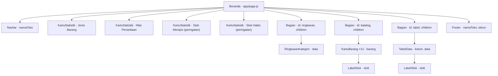

# Pohon Komponen — Inventaris Toko (Pertemuan 4)

Dokumen ini memetakan dekomposisi hierarki komponen (*Component Tree*) aplikasi Inventaris Toko beserta aliran data (*props flow*).

## Daftar Komponen & Peran
1. **`Navbar`**: Menampilkan nama toko berikon dan tautan navigasi anchor ke bagian halaman (`#katalog`, `#ringkasan`, `#tabel`, `#tentang`).
2. **`KartuStatistik`**: Kartu metrik responsif (grid 2/4 kolom) dengan penanda border kuning jika terdapat kondisi peringatan (*alert warning*).
3. **`RingkasanKategori`**: Komponen analitik penampil jumlah jenis barang, total unit, dan estimasi modal per kategori.
4. **`Bagian`**: Wrapper semantik (`<section>`) yang memanfaatkan `children` untuk merangkum konten dinamis.
5. **`KartuBarang`**: Kartu produk individual dengan deteksi stok habis (efek pudar `opacity-60`), formatting Rupiah, dan status stok.
6. **`LabelStok`**: Badge bersyarat 3 warna (*emerald* untuk tersedia, *amber* untuk menipis < 10, *red* untuk stok 0).
7. **`TabelData`**: Komponen tabel serbaguna berbasis mapping deklaratif kolom dan format tampilan dinamis.
8. **`Tombol`**: Komponen tombol serbaguna dengan dukungan 4 varian gaya (`utama`, `garis`, `bahaya`, `netral`), ikon `lucide-react`, dan rest props `...sisa`.
9. **`Footer`**: Penutup halaman dengan hak cipta dan tahun dinamis.
